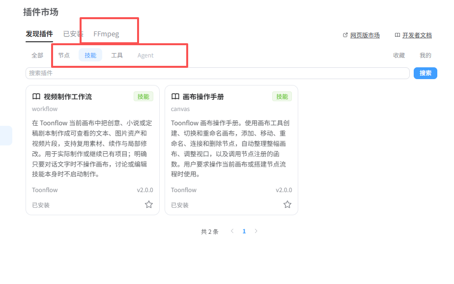
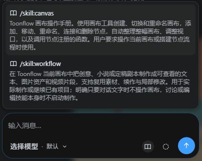
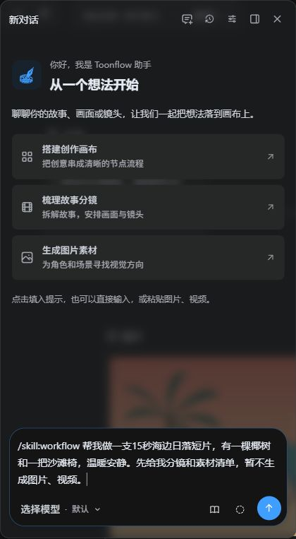

# Agent 助手

Toonflow 的右侧对话框不是普通聊天窗口：它带着工具与技能，能直接操作画布、生成素材、推进流程。

## 选择模型和技能

1. 打开项目中的 Toonflow Agent。面板关闭时，点击页面上的“Toonflow Agent”按钮重新打开。
2. 点击输入框下方的模型名称，选择已配置的文本模型；点击书本形状的“选择技能”，选择 `/skill:workflow`（视频制作工作流）。也可以输入 `/`，从列表选择技能。
3. 选中后，输入框会出现技能指令，直接在后面补充任务。要提供参考图，可把图片粘贴到输入区，再填写要求。

## 说清需求，确认后继续

1. 输入：“帮我做一支 15 秒海边日落短片，画面里有一棵椰树和一把沙滩椅，温暖安静。先给我分镜和素材清单，暂不生成图片、视频。”点击发送。
2. 助手提问时，在卡片中填写选项并点击“提交回答”。读完方案后，可以回复：“保留三个镜头，先生成第一个镜头的图片”，逐步推进。
3. 满意后继续说：“使用这张图片生成视频，椰树叶轻轻摇动。”需要修改时指出具体节点和内容，例如“只调暗天空，保留椰树与椅子的位置”。
4. 点击助手顶部“历史对话”找回之前的制作记录；开始另一件事时点击“新建对话”。回到旧对话后说明从哪个镜头继续，已有素材可以接着使用。

::: tip 一次配置，长期使用
你只需要安装和登录一次，后面继续用自然语言描述创作需求即可。
:::

## 给 Agent 加能力

助手能调用的工具与技能来自插件市场，也可以自己写。装好之后：

- 技能：在助手输入区的书本按钮中选择。
- 工具：由助手根据你的要求调用。

扩展方式见[插件市场](./plugin-market.md)与[插件、技能与提供方](/development/plugins)。
