# 项目、画布与节点

## 新建项目和画布

1. 在 Toonflow 首页点击“添加项目”→“选择空文件夹”，选择或新建“海边日落”空文件夹。浏览器版可在“选择服务器工作目录”弹窗中点击“新建文件夹”，输入名称并确认，进入新文件夹后点击“选择此目录”。

   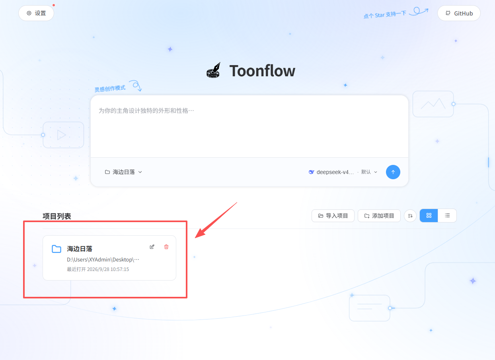

2. 进入项目后，点击左上角“画布1”旁的下拉箭头，再点击列表顶部的加号。输入“日落练习”，按 Enter。
3. 以后从这个列表切换画布；点击画布旁的编辑图标可以改名。继续旧项目时，从首页点击项目卡片，或用“导入项目”选择原文件夹。

   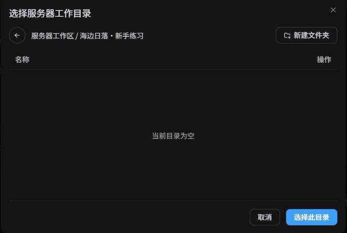

## 新建节点

1. 把鼠标放到画布空白处，按 <kbd>Tab</kbd> 或**在画布空白处双击**，即可快速新建节点。
2. 可以直接将图片、视频、音频等文件拖入画布。

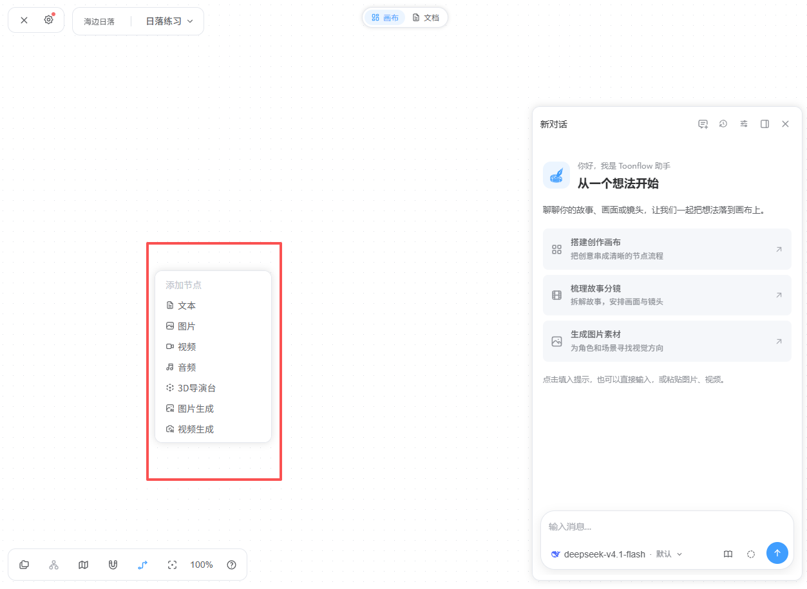

## 放入文字、图片、视频和音频

### 文本节点

用来展示文本信息，文本信息点击“编辑”可以手动输入或模型生成。

示例：点击文本节点内的“编辑”，输入“海边日落，一棵椰树旁放着一把空沙滩椅，暖橙色天空，海面平静”，关闭编辑窗口。以后再次点击“编辑”即可修改。

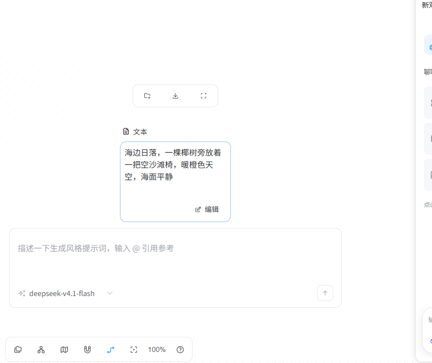

**语言模型生成方式**：可以输入自然语言或者结构化的提示词，让语言模型完成对应的文本生成任务。首次配置好语言模型后就能选取对应模型使用，生成结果会在**文本节点框**中显示。

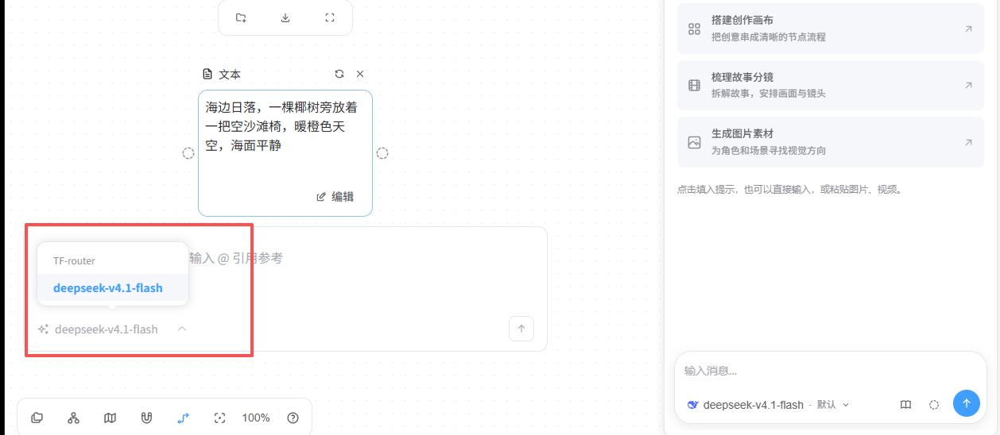

### 图片节点

点击图片节点中央的上传图标，选择参考图。选中节点后，可点击上方“全屏”查看，或点击“替换图片”换一张。

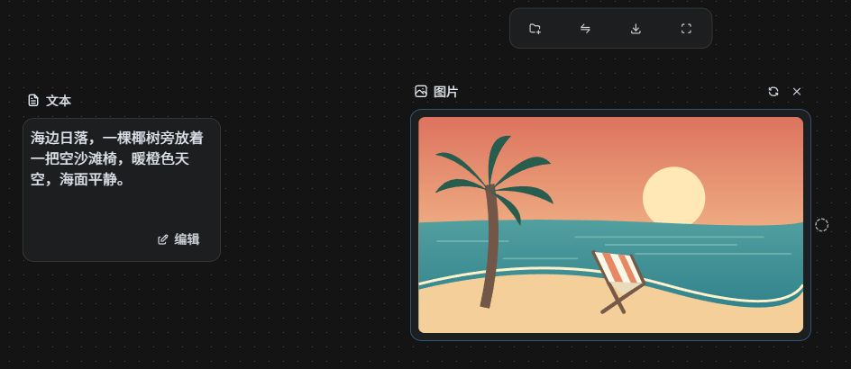

**图像模型生成**：图片生成器中接入了全能图片模型、Seedream 5.0 / 4.5 等，用户也可以自行接入。支持文生图、图生图、多图参考融合和图像编辑任务。

- 方法 1：在对话框中生成图片素材。
- 方法 2：右键添加图片生成节点，两个节点连线后，生成任务就会显示在**图片节点框**中。

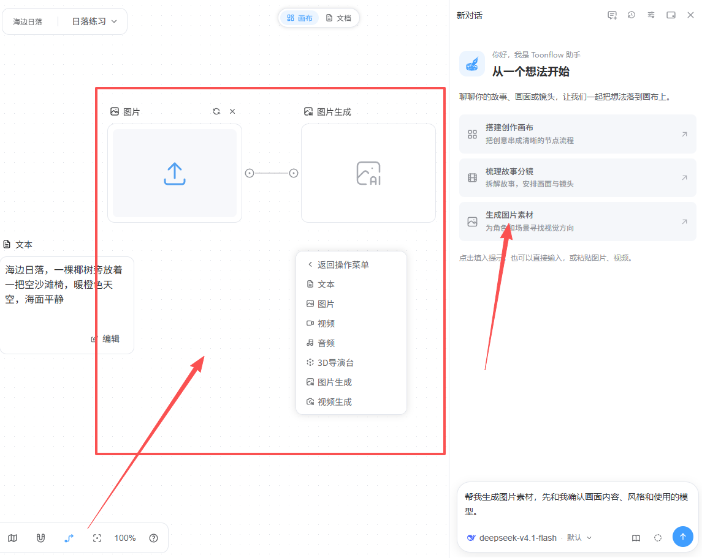

### 视频节点

添加“视频”节点，点击中央上传图标选择文件。

上传后点击播放、拖动进度条查看；点击“截取视频帧”，可将当前帧、首帧或尾帧放成图片节点。

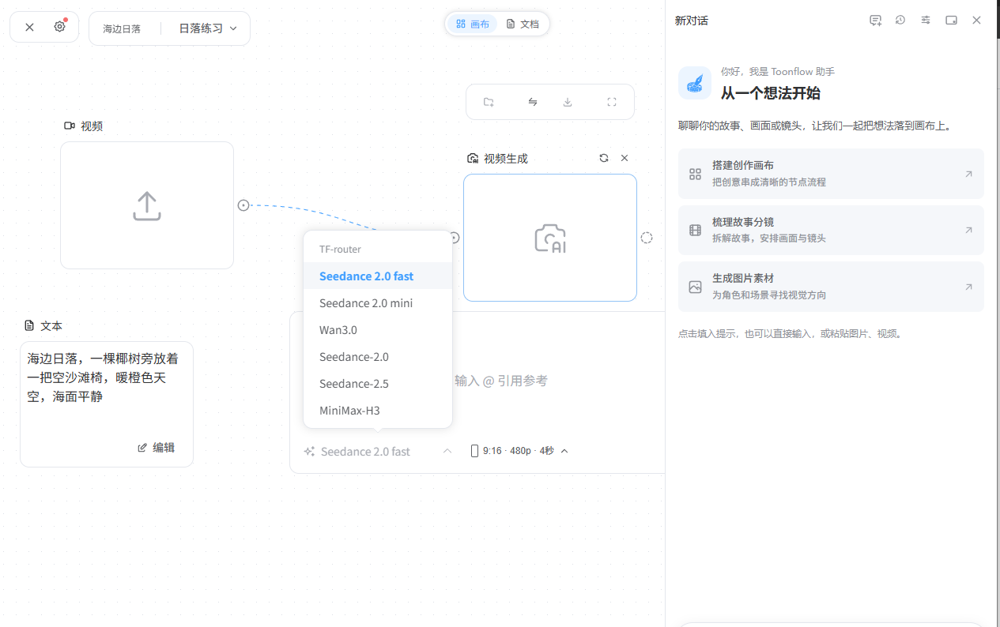

### 音频节点

添加“音频”节点，点击上传图标选择声音文件，再点击播放试听。图片、视频、音频也可以直接从电脑拖到画布，单个文件不超过 100 MB。

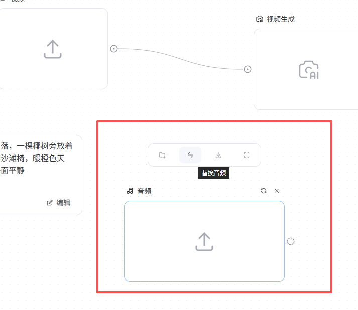

### 右侧对话框

剧本拆解、剧本资产管理、分镜头调整、提示词合成、批量生图、批量生视频串成一条完整流程。

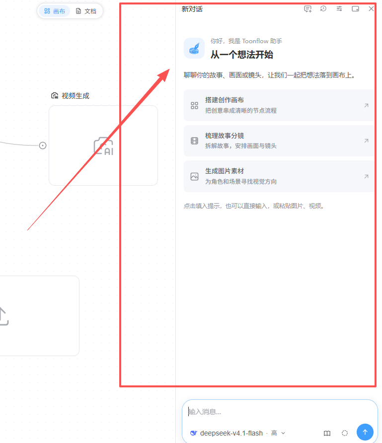

## 工作流的搭建

基于已有的**文本、图像、视频、音频 4 类节点**，可以**通过连线**自由搭建所需的任务工作流，之后就能快速完成复杂任务的**一键自动执行**或**分发**。

### 生成一张图片

1. 按 <kbd>Tab</kbd> 添加“图片生成”。从参考图片右侧的圆点拖到图片生成节点左侧的圆点，松开鼠标；再把文本节点连到同一个输入圆点。
2. 在图像生成器中输入生成需求：“参考图 1 的色调，按照文字描述生成海边日落画面，保留一棵椰树和一把沙滩椅生成一张图片”，选择生图模型、设置图像比例，最后点击生成。
3. 点击“选择模型”，选择支持参考图的图片模型；点击旁边的比例与尺寸区域，选择需要的选项，再点击向上箭头“生成图片”。
4. 图片出现后，点击上方“全屏”检查。连接的文本会一起参与生成；要换画面，先修改文本或提示词，再点击生成。

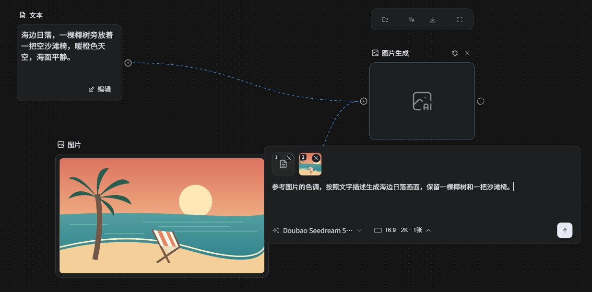

### 再让画面动起来

1. 按 <kbd>Tab</kbd> 添加“视频生成”，把生成的图片（或已有参考图）右侧的圆点连到视频生成节点左侧。选中视频生成节点，确认下方显示这张图片。
2. 输入：“海浪缓缓涌上沙滩，椰树叶轻轻摇动，沙滩椅保持静止，镜头缓慢推进。”选择支持图片参考的视频模型。
3. 打开生成设置，选择图片参考模式、时长、分辨率和比例，点击“生成视频”。完成后在节点中播放，检查运动是否自然。

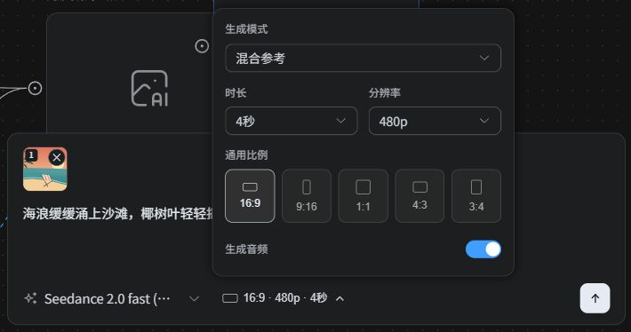

## 平移、缩放、复制和分组

1. 按住空格拖动画布，按住 <kbd>Ctrl</kbd> 滚动滚轮缩放。按 <kbd>H</kbd> 切换抓手，按 <kbd>V</kbd> 切回移动工具；找不到内容时按 <kbd>Ctrl</kbd> + <kbd>0</kbd>。
2. 右键节点选择“创建副本”，在副本上尝试新提示词，保留原来的结果。删除时选“删除节点”；误操作可按 <kbd>Ctrl</kbd> + <kbd>Z</kbd> 撤销。
3. 按 <kbd>V</kbd>，在空白处拖出选框，选中多个节点。对于搭建好的工作流，可全选后点击右键进行打组；打组后可整体拖动，选中分组后点“解组”拆开。

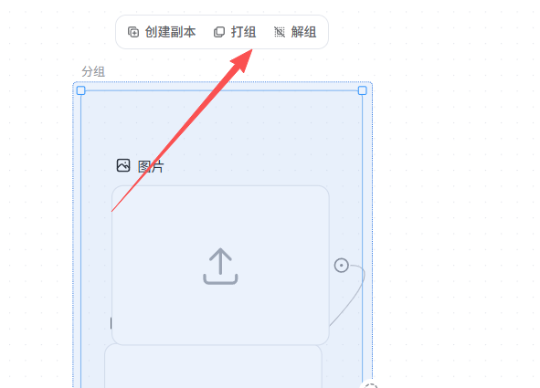

4. 选中有结果的节点，点击上方“下载”图标保存图片或视频。画布修改会自动保存，下次打开原项目即可继续。

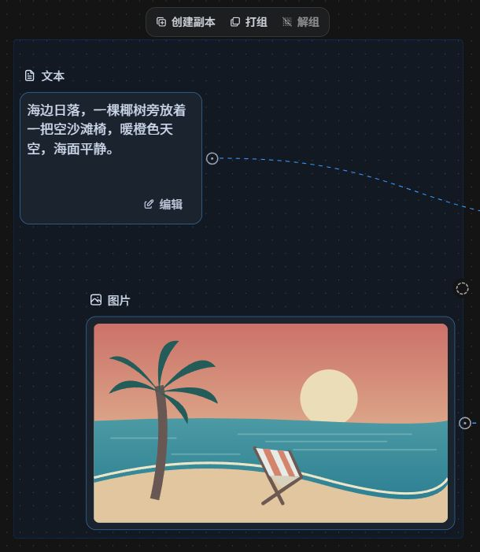
