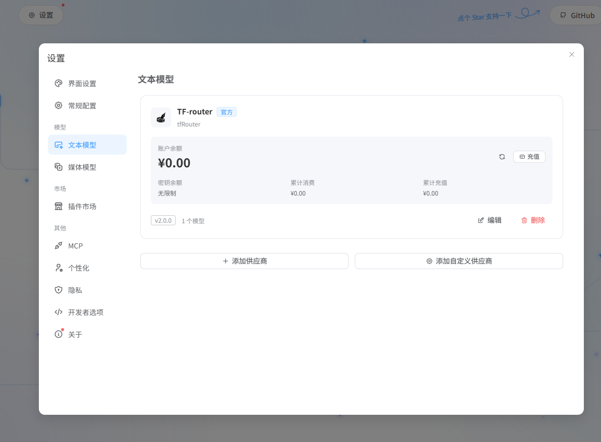
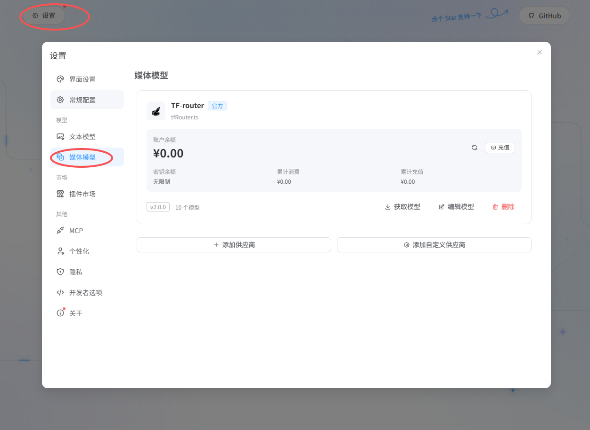
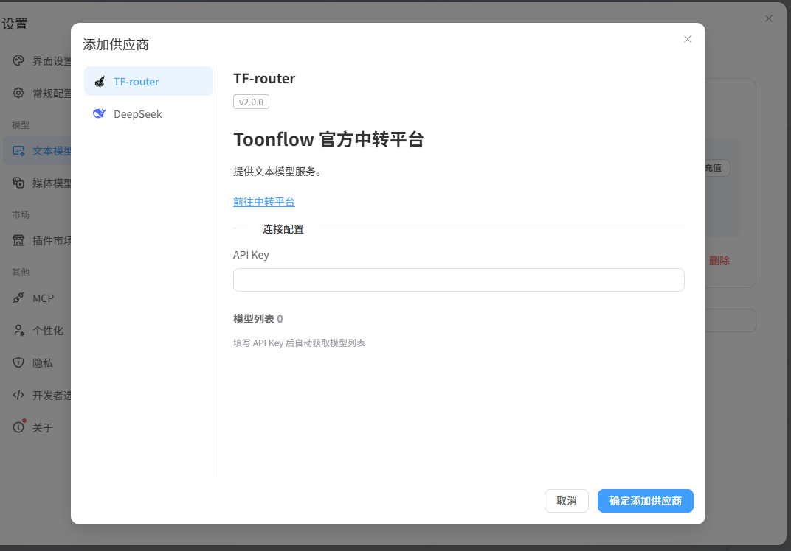
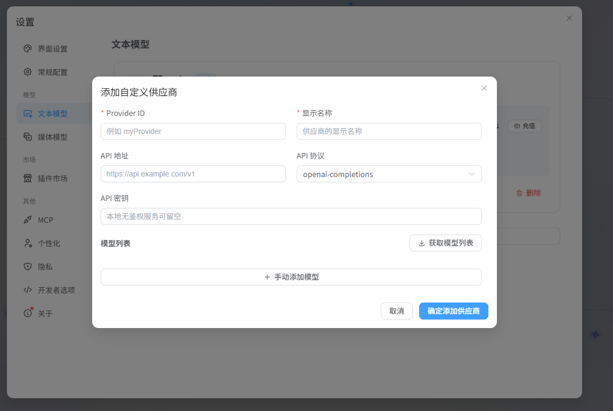
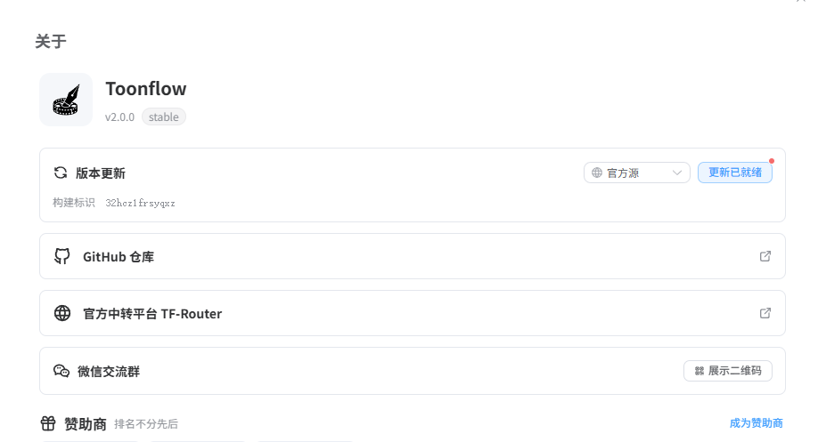

# 新手入门

Toonflow 是开源 AI 创作平台，融合无限画布、AI Agent 与可视化工作流，支持图像生成、视频生成、智能分镜及短剧创作。支持本地部署、自由接入模型，提供跨平台桌面端，并可通过 MCP 与插件扩展创作能力。

- 源码与安装包：[github.com/dolfly/toonflow](https://github.com/dolfly/toonflow)
- 还没安装客户端：先看[下载与安装](./install.md)

## 配置模型

Toonflow 本身不提供模型算力，文本、图片、视频能力都来自你配置的模型服务。首次打开按下面三步走完，就能开始创作。

1. 首次打开时，可点击“登录 TF-Router 自动配置”。已经使用其他模型服务时，打开“设置 → 文本模型”，添加供应商，填写服务提供的地址与密钥，选择模型并保存。

   

2. 再打开“设置 → 媒体模型”，添加图片、视频供应商，点击供应商卡片上的“编辑模型”，填写 API Key 并点击“保存”。文本模型供助手使用，图片和视频模型供生成节点使用。

   

3. 回到项目后，在各自的模型下拉框中选择已配置的模型。图片参考、视频时长和声音等选项，以当前模型显示的内容为准。

   

   

::: tip 官方中转平台
懒得多家比价时可以直接用官方中转平台：<https://api.toonflow.net>。也可以随时接入第三方 API 或本地模型 / ComfyUI，Toonflow 不强制绑定渠道。
:::

## 接下来读什么

| 想做的事 | 从这里开始 |
| --- | --- |
| 建项目、加节点、连工作流 | [项目、画布与节点](./canvas.md) |
| 管素材、用 3D 导演台取景 | [素材库与 3D 导演台](./tools.md) |
| 把图片镜头合成视频 | [视频合成](./video.md) |
| 装节点、工具和技能 | [插件市场](./plugin-market.md) |
| 让 Agent 帮你推进整条流程 | [Agent 助手](./agent.md) |

::: warning 教程里的演示数据
本教程沿用“海边日落”的练习项目，路径、模型名与金额均来自录制时的环境，实际操作时以你自己配置的项目与模型为准。
:::

## 关于 Toonflow 2.0：作者的一封信

Toonflow 2.0 发布时，作者写了一封信说明项目的处境与决定。原文照录：

> 距离上一次更新，已经过去了三个月，今天 Toonflow 2.0 正式发布了。
>
> 很抱歉，让大家等了这么久。今天，我们终于带着承诺回来赴约更新了。
>
> ToonFlow 是一个完全免费、全开源的项目。从第一天起，我们想做的事就很简单：把「小说 → 角色 → 剧本 → 分镜 → 成片」这条路修通，再修短一点，让有故事、有想法的人不必被复杂的工具和流程挡在门外。
>
> 只是这三个月，我们不得不停下来，先想办法让开发继续下去。这段时间，持续的支出已经让我们难以维系开发。我们尝试了各种办法，但始终没能缓解资金压力。我们仍然想把 ToonFlow 做下去，只是为爱发电，也得先吃饱饭。
>
> 这期间，一位和我们一起做核心开发的伙伴选择了离开，去追求更适合自己的发展。我们理解。一起坚持了这么久，告别时难免不舍。那段时间，面对迟迟没有缓解的困境，我们也曾情绪低落，也问过自己还能坚持多久。只是想到 ToonFlow 还有没做完的事，还是想再试一试。
>
> 最困难的时候，我们也想过，要不要给 API 加一点价，甚至把模型调用限定在 TF-Router 上。这样做，或许能减轻一些压力。
>
> 但最终，我们没有加价，也没有限制接入方式。所以，新版本依然可以自由接入第三方 API，不强制绑定渠道，也不限制大家的选择。TF-Router 会是一个选项，但不会是唯一的路。
>
> 在这里也要认真说声谢谢：这次开发所用的 Codex 算力，都是群友们东拼西凑出来的。在我们连开发支出都困难的时候，是大家的帮忙，让后面的工作得以继续。
>
> 所以，今天能交出这份更新，真的离不开你们。之前那封信里答应大家的事，我们也一直记着。这次，终于把它们带来了：
>
> - ToonFlow 的开源协议从 Apache-2.0 更换为 MIT License。无论个人创作还是商业使用，都不需要额外向我们申请授权；只需按 MIT 协议的要求保留版权及许可声明。
> - 自由扩展的插件系统：节点、工具、技能……你需要的能力，不必再全部等着我们来更新。
> - 核心创作流程已经完整跑通：从小说到角色，从剧本到分镜，再到成片。
>
> 眼下的困难还没有完全解决，但我们仍然会努力保证今后的更新节奏。但这次更新，我们总算做完了。让大家等了三个月，终于有了一份交代。
>
> 谢谢那些在断更期间还愿意等一等的人，谢谢帮忙反馈、出主意、凑算力的人，也谢谢每一个还记得 ToonFlow 的人。
>
> 隔了三个月，还能继续和大家说 ToonFlow 的新进展，我们真的很高兴。
>
> 祝你们创作顺利，也愿我们能继续活下去。
>
> 谢谢大家

