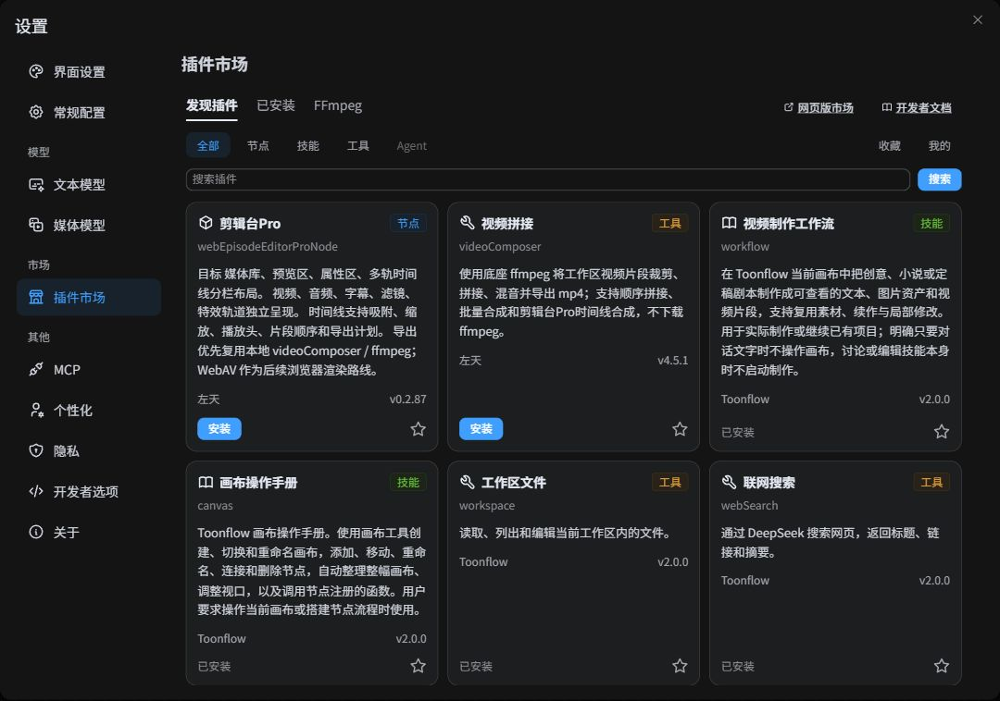

# 插件市场

1. 点击“设置 → 插件市场”，在“发现插件”搜索需要的功能，点击卡片阅读说明，再点击“安装”。页面要求验证时，填写 TF-Router API Key 并点击“保存并继续”。
2. 安装后切到“已安装”查看；卡片有“配置”时，先填写需要的内容并保存。已有本地插件文件，可点击这里的“安装插件”导入；市场显示“更新”时可更新该插件。
3. 节点装好后，在画布右键菜单或 Tab 菜单中使用；技能在助手输入区的书本按钮中选择；工具由助手根据你的要求调用。
4. 例如，安装画布节点可增加制作方式，安装技能可补充创作流程，安装工具可增加搜索或文件操作能力。Agent 类别显示“测试阶段，暂未开放”时，先使用已有类别。

## 扩展类型

| 扩展类型 | 用途 | 开发入口 |
| --- | --- | --- |
| 节点 | 为画布增加交互组件、输入输出端口与节点操作。 | [节点脚手架](https://github.com/dolfly/toonflow/blob/master/packages/nodeScaffold/readme.md) |
| 工具 | 为 Agent 增加工作区操作、搜索、媒体生成等能力，可附带交互 UI。 | [工具脚手架](https://github.com/dolfly/toonflow/blob/master/packages/toolScaffold/readme.md) |
| 技能 | 用 `SKILL.md` 和附属资料描述创作流程、方法与操作约定。 | [内置技能](https://github.com/dolfly/toonflow/tree/master/packages/skills) |
| 提供方 | 适配不同平台的模型列表、请求参数和媒体返回结果。 | [提供方实现](https://github.com/dolfly/toonflow/tree/master/packages/providers/src) |

也可以在桌面客户端里通过 `toonflow://install` 链接唤起安装，或用第三方 Coding 工具通过 MCP 操作 Toonflow。这两条路径的细节见[插件、技能与提供方](/development/plugins)。

## 插件从哪来

- 网页版市场：<https://api.toonflow.net/console/plugIn>
- 开发者文档：[飞书文档](https://qcn7xdsqgc4z.feishu.cn/docx/KNBNd9naqolsy6xjAOCcEAkqnRd)
- 自己写：见[插件、技能与提供方](/development/plugins)
