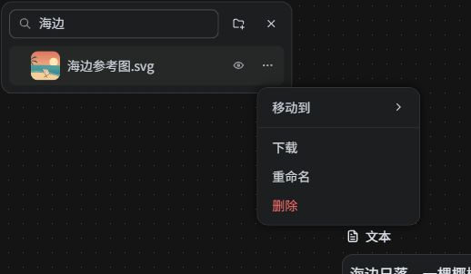
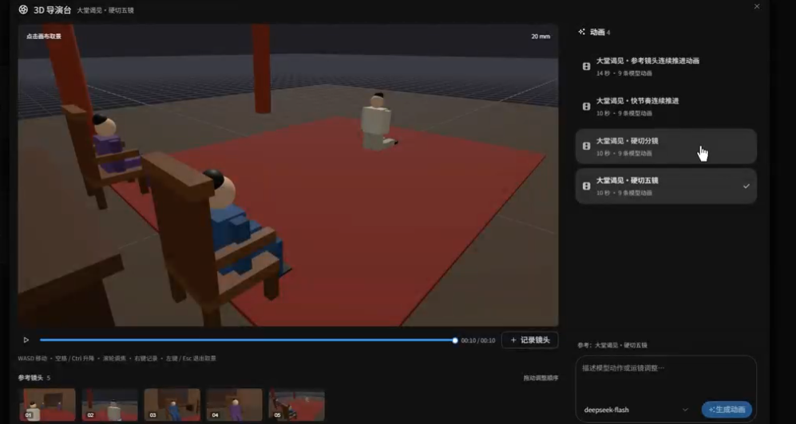
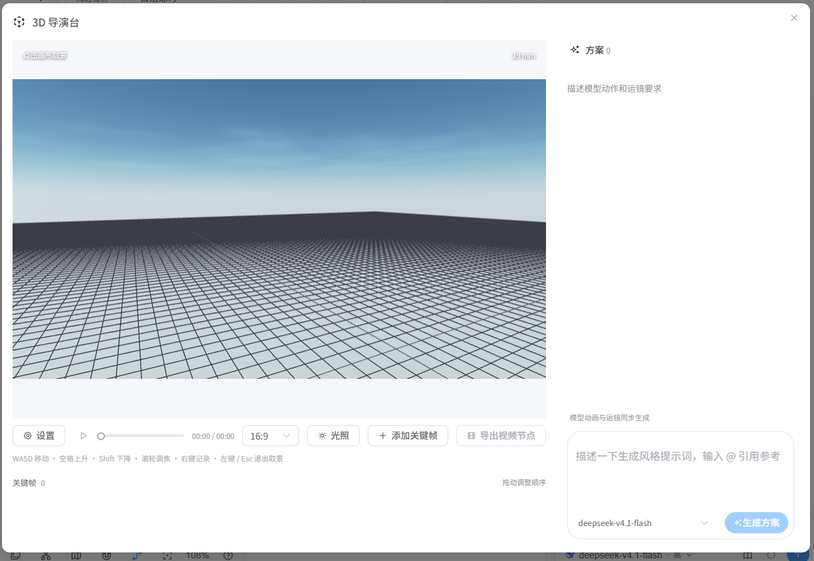
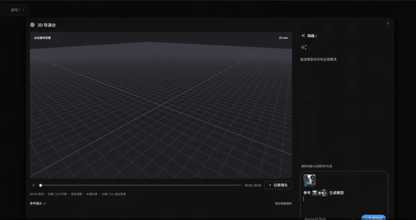
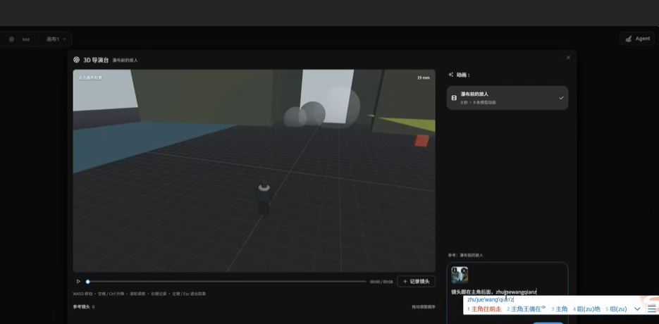
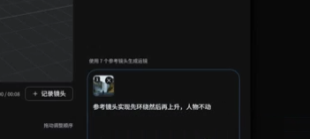

# 素材库与 3D 导演台

## 素材库

1. 右键结果节点，选择“保存到素材库”，填写完整文件名、选择位置，再点击“保存”。
2. 点击画布左下角“素材库”，搜索刚才的名称。点击预览按钮查看内容，把文件拖回画布即可复用。
3. 点击素材库顶部“新建文件夹”，按角色、场景或集数整理。右键素材还能重命名、移动或下载。
4. 画布变大后，可点击左下角地图图标定位内容，或点击“整理画布”自动排布节点；需要恢复时点击弹出的“撤销整理”。

## 3D 导演台

导演台是一个 3D 构图节点，帮助用户用摆积木的方式搭建故事空间，通过多视角截图，快速得到可被 AI 图像 / 视频模型准确理解的构图参考。

### 快速上手

1. 按 <kbd>Tab</kbd> 添加“3D 导演台”，点击节点预览打开。先点“设置 → 添加人偶”，用一个简单人物练习取景。
2. 点击三维画面进入取景，用鼠标调整朝向，<kbd>W</kbd><kbd>A</kbd><kbd>S</kbd><kbd>D</kbd> 移动，空格上升、<kbd>Shift</kbd> 下降，滚轮调焦。
3. 点击“添加关键帧”记录取景，按 <kbd>Esc</kbd> 退出。想生成动画时，在右侧选择文本模型、输入场景和运镜要求，再点击“生成方案”。
4. 点击关键帧的导出按钮生成图片节点，或点击“导出视频节点”保存动画。导出期间保持当前窗口可见，完成后回画布查看。

### 基础使用步骤

1. 新建“3D 导演台”节点，点击「打开导演台」进入 3D 空间。

   

2. 连接节点生成模型。

   

3. 在对话框描述模型动作和运镜要求。

   

   

::: tip 导出建议
导演台的导出结果是构图参考，不是最终成片。把导出的图片或视频节点接进图片生成 / 视频生成节点，再补充文字提示词，效果更可控。
:::
