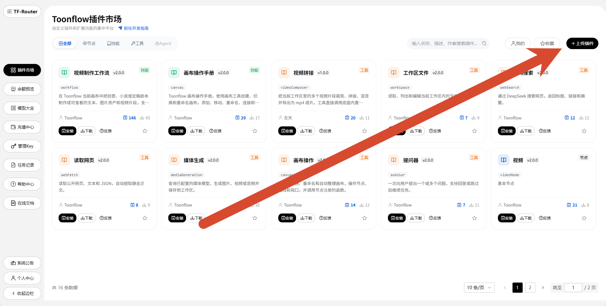

> **开发完成后，可直接上传到 Toonflow 插件市场，无需向项目仓库提交 PR。**

上传入口：[https://api.toonflow.net/console/plugIn](https://api.toonflow.net/console/plugIn)

1. 打开上方链接并登录账号，进入「Toonflow 插件市场」。
2. 点击页面右上角的「＋上传插件」按钮。
3. 按页面提示上传已完成验证的插件文件，填写相关信息并提交。

上传入口示意：点击右上角「＋上传插件」（下图中红色箭头所示）。

